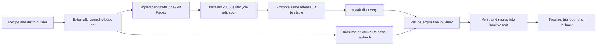

# P14 release engineering proposal

Status: approved by Vince on 2026-11-11; implementation started. Production
enablement remains pending applicable validation. Full builds and VM tests are
not authorized. This replaces the assumption that somebody else must first
supply an update service.
Scope: native Linux x86_64, LevitateOS and AcornOS, base and desktop systems.

## Recommended service and cost

Use the existing public `LevitateOS/LevitateOS` GitHub repository:

- GitHub Pages serves the small signed discovery metadata.
- GitHub Releases serves immutable system payloads and recovery media.
- GitHub Actions deploys metadata and refreshes its signed freshness window.
- Existing x86_64 build/validation machines produce artifacts through Recipe
  and the distro builder. Publication consumes those explicit artifacts.

Provisioned metadata base:
`https://levitateos.github.io/LevitateOS/updates/`.
GitHub Pages reports the canonical HTTPS project URL with no custom domain,
workflow deployment and HTTPS enforcement. No custom domain purchase is required.
Public authority/provisioning metadata has been deployed and all nine public
files verified over HTTPS through Recipe/Ginux. No release
index or installed production default is enabled by provisioning.

Use `/levitate/stable/x86_64/index.json` and
`/acorn/stable/x86_64/index.json` below that base. Each index selects one current
release per supported flavour and binds its init/libc profile. Candidate feeds
use the corresponding `/candidate/x86_64/index.json` paths.

Public-repository Pages and standard Actions runners are available on GitHub
Free. Releases currently permits up to 1,000 assets per release, each below
2 GiB, without an aggregate release-size or download-bandwidth limit. Pages
currently limits a site to 1 GB and has a soft 100 GB/month bandwidth limit.
Keep images out of Pages, Git history and Actions artifact storage. These are
provider limits, not a promise of permanent free hosting or availability.
[Pages availability](https://docs.github.com/en/pages/getting-started-with-github-pages/what-is-github-pages),
[Pages limits](https://docs.github.com/en/pages/getting-started-with-github-pages/github-pages-limits),
[release limits](https://docs.github.com/en/repositories/releasing-projects-on-github/about-releases),
[Actions billing](https://docs.github.com/en/billing/concepts/product-billing/github-actions).

This recommendation has no recurring hosting bill under those public-service
terms and limits. Existing build hardware, electricity and backups still cost
resources. Paid runners, private-repository capacity and object-storage overages
are not part of it. Cloudflare R2 is a possible later hosting move, but its 10 GB
free storage allowance and non-production `r2.dev` endpoint do not give the same
zero-bill starting point. Do not implement a second hosting backend for launch.
[R2 pricing](https://developers.cloudflare.com/r2/pricing/),
[R2 public endpoint limits](https://developers.cloudflare.com/r2/platform/limits/).

## What remains and what changes

Keep one release manifest and the existing Recipe acquisition, recab cache,
O/C/N merge, incremental root synchronization, finalization and trial engines.
The EROFS system image, intended inventory, kernel and initramfs remain one
verified release set. The same manifest and payload bytes serve online updates
and installation media. No package manager, alternate updater or new boot engine
is added.

The current protocol cannot deploy this service unchanged. It restricts payloads
to the index origin and derives nested artifact URLs from their media paths.
GitHub Release assets have flat names and redirect to a download CDN. Current
trust also has one signing key without delegation or feed expiry. Implement the
following changes in the existing contract, builder and recab owners.

| Existing owner | Required change |
| --- | --- |
| `distro/contract/src/release.rs` | Explicit production policy version, delegated signing roles, version 2 discovery index, signed transport locations, audience and freshness checks. Keep the version 1 system manifest and its inventory authoritative. |
| `distro/builder/src/release_manifest.rs` | Validate a release-signing key against the root-signed public delegation before signing the existing manifest. Include the public verification chain on media. |
| `distro/builder/src/release_index.rs` | Produce chunk assets, their signed location descriptions and the Pages metadata tree; serialize sequence allocation and publish index last. |
| `tools/recab/src/update.rs` and `release.rs` | Verify the delegation/index proof, acquire authorized parts through Recipe, resume verified parts, assemble and verify the original artifact, then use the existing release validator and merge. |
| `distro/builder/os-recipes/update-acquire.rhai` and its renderer | Declare the explicit metadata, asset and redirect endpoints. Keep bounded exact-byte acquisition and a small request input. |
| `xtask` and `.github/workflows/` | Add explicit release publication orchestration around the builder and GitHub tooling, using existing artifacts. No implicit OS builds. |
| Existing CLI/frontends and install/runtime scenarios | Report freshness, authority and transport failures; retain the existing candidate/fallback decisions and independent named scenarios. Add explicit base/desktop artifact selection where installed scenarios currently assume the base system. |

## Release identities and publication slots

Start the production `stable` channel at release sequence 1 for each distro,
shared by that distro's base/desktop release campaign. Subsequent releases
deliberately advance their sequence;
never derive ordering from a timestamp or version string. OS version, source
commit/submodule pins and Recipe source digests remain recorded alongside it.
Index sequence is separate and increases for every feed publication or refresh.

`candidate` and `stable` are discovery audiences. Both describe the same
`identity.channel = stable` release. Candidate validation therefore does not
require rebuilding an image just to change its channel or signing it under a
different release identity. The signed index states its audience and the
installed policy states the expected audience; a stable client refuses a
candidate index served at the wrong address.

Normal installations use the stable URL. Explicit disposable candidate installs
personalize the candidate discovery policy before both roots are sealed, using
the existing installer fixture mechanism. This is local configuration retained
by the preserving merge. It never changes the normal installed defaults.

Release asset tags are unique and descriptive:
`os-<distro>-x86_64-<flavour>-<sequence>-<manifest-id-prefix>`.
The complete manifest digest, not its displayed prefix or tag, is the release ID.
Publish assets on a draft release, verify them, then publish with immutable
releases enabled. Never overwrite an asset or move a published tag.
[GitHub immutable releases](https://docs.github.com/en/code-security/concepts/supply-chain-security/immutable-releases).

## Transport and the GitHub asset limit

Keep artifact paths such as `live/filesystem.erofs` and `boot/vmlinuz` in the
system manifest. The signed discovery entry supplies an exact transport map
for those paths; URLs are not inferred from the paths or from incoming rootfs
configuration. This separates delivery location from system identity.

Each map value is an ordered list of parts containing `offset`, `size`, SHA-256
and HTTPS URL. Parts are at most 1 GiB. Small artifacts use one part; larger
images use multiple parts so the 2 GiB asset limit cannot block desktop releases.
Use flat content-addressed asset names, with the original basename for clarity.
Part ranges must be contiguous, non-overlapping and exactly cover the manifest's
artifact size. Limit each artifact to 64 parts and reject a publication exceeding
GitHub's asset count. Every reconstructed artifact must match the original
manifest's complete SHA-256 and size; part signatures never replace this check.

Metadata, manifests, their signatures and public key documents live on Pages.
Each entry references the existing immutable
`releases/<manifest-id>/release.json` and `release.sig` metadata paths. Payload
URLs point to the exact proposed repository's `releases/download/<tag>/` prefix.
Continue publishing `index-signatures/<index-sha256>.sig` before `index.json`.
An old index remains verifiable while a new deployment propagates.

Production policy allows only the canonical Pages origin, the exact release
asset prefix on `github.com`, and the verified HTTPS redirect host
`release-assets.githubusercontent.com`. Check actual redirect behaviour before
sealing the policy; any additional hostname needs an explicit policy change.
Do not grant wildcard GitHub domains or general Internet access. GitHub
documents that CDN hostname for release downloads.
[GitHub download domains](https://docs.github.com/en/actions/reference/runners/github-hosted-runners).

Recipe resolves the declared hosts to bounded Ginux network grants and handles
TLS and redirects. Recab supplies only the endpoint set needed for that request
and its allowed redirects. Add explicit redirect URL validation in Recipe where
needed: HTTPS only, bounded hops, no credentials, and no destination outside
the installed allowlist. A signed location cannot expand that allowlist.
Authentication uses Ed25519 and artifact hashes in addition to TLS. Clients
need no GitHub token or GitHub API calls, including for ordinary update checks.

## Signing, custody and recovery

Use separate authority for each distro, with three Ed25519 roles:

| Role | Custody and authority |
| --- | --- |
| Root | Offline private key, public anchor installed in both roots and recovery media. Authorizes/revokes the two operational signing roles and their validity periods. Never a CI secret. |
| Release | External private PKCS#8 file on the trusted release machine. Signs exact system manifest bytes after applicable artifact validation. Never included in Recipe inputs or uploaded to GitHub. |
| Index | GitHub environment secret, available only to the default-branch publication/refresh workflow. Signs discovery/transport/freshness metadata, not system manifests. |

This keeps an index-host/CI compromise from forging a new system image. It can
still withhold updates or select an otherwise authorized release; signatures do
not make hosting availability trustworthy. A compromised release signer has
system-update authority until revoked. Root-key compromise needs trusted
recovery media; do not claim an automatic cryptographic escape from a stolen
trust anchor.

The root signs a bounded public `release-keys.json` document: version, distro,
channel, issue/expiry times, active release/index public keys, key IDs derived
from the public bytes, and revoked key IDs. Retain versioned documents and
detached signatures. Media and the verified cache carry the public chain needed
for offline verification. The existing raw `release.sig` can remain 64 bytes:
verify against the bounded set of authorized release-role keys, never index keys
or a public key supplied without the root proof.

Production policy explicitly names its format and root anchor; do not reinterpret
an old single release key as a new root key. Root rotation requires a versioned
transition signed by both the current and successor roots. Readers verify the
bounded sequential chain and retain the highest accepted authority version.
Keep old transition documents reachable for machines that skipped releases.

Generate production keys only after design approval. Working private files live
outside the checkout and build/publication trees, for example under
`~/.local/share/levitateos/release-keys/<distro>/`, owned by the release operator
with directory mode 0700 and file mode 0600. The provisioning scope keeps these
working files private and sends only index-role keys to GitHub. Additional offline
backup setup was deferred by Vince during provisioning; it is an operational
follow-up, not an extra approval or provisioning gate. Do not claim an offline
backup exists until one is actually made and checked.

Transfer the index key into the protected GitHub environment through stdin/API
secret handling. On a runner, materialize it only in a private temporary memory
filesystem, disable shell tracing and remove it on exit. Logs show public
fingerprints, artifact IDs and results, never private key bytes. Secret-free
builds/checks and publication signing run in separate trust contexts.

Operational key rotation is root-signed authorization of a successor, an overlap
period, then revocation of the old key. Loss of an index or release key is
recoverable with the offline root. Revocation stops new acquisitions and
unapplied cached releases signed only by a revoked key once that revocation is
known. It must not disable booting or rolling back to a retained known-good
generation. Offline clients cannot learn a new revocation until they reconnect.

## Freshness and rollback protection

Version 2 indices contain `issued_at`, `expires_at`, audience and monotonic index
sequence. Refresh daily, expire after 14 days, and reject a validity window
longer than 14 days. Reject future issue times beyond a small documented clock
tolerance. Root-signed operational key authorization lasts at most one year;
renew it before expiry, with alerts 30 days beforehand.

The root authorization also binds an index epoch. A root-authorized epoch
increase can recover from a compromised index signer's poisoned sequence
counter. It resets only index counters; accepted system-release floors and
signed time remain intact. Routine releases, Recipe changes and root rotations
do not implicitly change that epoch. Release floors advance only after the
release-role signature and manifest binding are verified, never from an index
signer's claim alone.

Store accepted authority/index/release floors under shared recab state, keyed
by root anchor, distro, channel, audience and full execution profile. They must
survive A/B boots, system rollback and changes to release sequence or acquisition
recipe bytes. The current source fingerprint includes those changing values;
it must not reset the production anti-rollback floor after an ordinary update.
The trust lineage retains its original identity through an authenticated root
rotation; installing a successor root cannot reset any of these floors.
Refuse changed bytes at an already accepted sequence.

Expired discovery metadata blocks fresh discovery/acquisition, with a clear
clock/freshness error. It never blocks boot, trial fallback or ordinary rollback.
A completely downloaded release verified while metadata was valid remains
available for explicit offline apply, unless a locally known revocation forbids
it. Preserve its original signed index, delegation and manifest proofs in the
pin; reverify them and all payloads rather than trusting cached status flags.

Clock sanity matters for HTTPS and freshness. Report an unset/backwards clock
against the last accepted signed time; do not bypass TLS, erase sequence floors
or mark the installed system unhealthy merely because discovery cannot run.

## Publication and promotion

Extend the existing builder publisher and `cargo xtask` front door. Use the
existing GitHub tooling for remote release operations; recab remains unaware of
GitHub APIs. The workflow is explicit and resumes the same release ID:

1. Select the exact source commit, submodule pins, distro/profile, release
   sequence and already produced artifact directory. The existing producer
   provenance and complete root/boot binding checks must pass. An unsigned
   build is not silently promoted by renaming files.
2. Validate the root authorization and external release key before writing
   public outputs. Emit/verify the single manifest and detached signature.
   Record the source/input hashes and applicable scenario run identities.
3. Produce the bounded transport parts and local metadata tree. Create a draft
   GitHub release, upload assets and compare server-reported/downloaded bytes
   with the local hashes. Public download verification uses the Recipe producer.
   Resume matching assets; refuse conflicting ones.
4. Publish the immutable payload release. Add its signed discovery entry to
   the candidate audience only. Candidate metadata commits contain public
   material and use the existing default branch, never a `gh-pages` branch.
5. Run installed check/download/apply and the P13 lifecycle against that actual
   public service on x86_64 with both distros. Use fresh compatible paired
   installations and their explicit existing artifacts. No implicit rebuilds
   or prerequisite scenario ladder. The candidate URL is personalized before
   sealing the disposable installations. An explicit local producer/edit adds
   X so acquisition and release merging must prove that it survives.
6. Promote the exact manifest ID and unchanged payload bytes to the stable
   index after the applicable evidence passes. Allocate a new stable index
   sequence, sign, deploy the complete Pages metadata tree and verify the
   public index/signature/manifest paths. A failed upload or Pages deployment
   leaves the previous stable discovery usable.

Bootstrap requires an installable baseline release and a genuinely newer
release for each advertised profile: for example sequence 1 followed by 2.
Discovering sequence 1 from a sequence-1 installation cannot prove download and
apply. Retain both explicit artifact sets for the initial online acceptance run.

Use a publication record to resume completed external steps; never rebuild or
re-sign an object into a different identity during recovery. Serialize metadata
writers across both distros/audiences, including daily refreshes. Sequence
allocation, current references and public proof files are reviewed default-
branch metadata commits; concurrent stale-base publication refuses/retries.
Use a shared GitHub Actions concurrency group with cancellation disabled.
Publication/refresh deploys Pages in the same workflow after committing metadata;
it must not rely on a `GITHUB_TOKEN` push triggering another workflow. An
independent metadata deployment rereads the current default-branch head, so an
older queued job cannot restore an earlier site snapshot. The refresh workflow
only renews current references; it does not select a new
release, rebuild a system or change user boot selection.

GitHub Actions needs `contents: write` for release publication, and `pages: write`
plus `id-token: write` for Pages deployment. Keep read-only defaults for ordinary
jobs and no production secrets on pull-request jobs. Pin action dependencies to
reviewed commits. Use public-repository environment restrictions for publication
and the sole default branch; release triggering is explicit. Initial design
approval and final service enablement are Vince's decisions, not an automatic CI
side effect. [Environment capabilities](https://docs.github.com/en/actions/how-tos/deploy/configure-and-manage-deployments/manage-environments).

## Client storage and lifecycle

`recab update check`, `download` and `apply` stay the public lifecycle. Every
network request runs through the installed Recipe producer in Ginux. Checking
and downloading cannot change the active/prepared trees, preparation revision,
boot entries or firmware selection.

Reassemble into one private partial artifact at its original logical path.
After a verified part is flushed, record its completion. Retry rehashes completed
parts in that file; a failed part restarts at its boundary. Do not keep both a
permanent chunk cache and a second complete assembled image. After the final
whole-file hash and existing complete release validation, atomically publish the
verified cache entry. Resume decisions use authenticated part descriptions.

Preflight shared-state capacity for remaining artifact bytes, one Recipe part's
staging/export overhead and bounded metadata, separately from expanded inactive
root capacity and ESP capacity. Report the actual missing capacity. Transport
parts are distinct from recab's existing fine-grained root synchronization.
Downloading a release still transfers its full compressed image; this proposal
does not claim network delta updates or physical SSD wear savings. Continue
reporting Recipe, assembly, root and ESP writes without double-counting.

Applying uses the existing preserving merge and reports conflicts. Finalize and
trial scheduling remain explicit, with automatic health assessment/fallback on
boot. No unattended system apply, automatic reboot or destructive continuation
is introduced. Stable release failure is handled by retaining the known-good
slot; fleet remediation publishes corrected content at a higher release sequence.
Never lower the signed feed sequence or silently reinstall an older image.

## Retention and incidents

Keep published payload releases and historical public proofs for launch; do not
automatically delete objects that an offline/pinned client might still need.
Keep only small metadata on Pages, preserve addressed index signatures, and
archive historical raw indices with release records rather than adding an
unbounded daily history to the Pages site. Refuse metadata deployment above a
256 MiB safety limit. Revisit retention from measured growth, not automatic
deletion of old user fallback generations.

If the service is down, discovery fails clearly and installed systems continue
working. Retry 429/temporary failures with bounded backoff, respecting Retry-After;
do not hammer the origin or bypass Recipe. A rollback/equivocation/signature
failure is an error, not an automatic switch to another mirror. A planned host
move is an authenticated policy update while the old service still works.

Run secret-free scheduled checks of public metadata/signature/expiry reachability
and representative asset availability. Retain failure logs as workflow results;
use GitHub's normal notification controls. No external monitoring subscription
or outbound messaging integration is required.

## Implementation order and completion

After approval, implement these coherent steps in the existing owners:

1. Public production policy/delegation/index contracts, compatibility refusal
   and durable shared freshness/sequence handling.
2. Recipe endpoint/redirect handling and recab's authenticated part acquisition,
   assembly, retry and offline verification.
3. Builder delegation-aware signing, part publication and deterministic feed
   generation; focused real CLI/filesystem/HTTP(S) checks with disposable keys.
4. Default-branch GitHub publication, refresh and monitoring workflows; external
   key bootstrap and public installed defaults for both distros.
5. Public candidate deployment, exact-artifact installed/boot evidence and stable
   promotion, when the corresponding full builds/VM runs are authorized.

Validation must include wrong-role/revoked signatures, replay/equivocation,
expired metadata and bad clocks, CDN/redirect refusals, altered/truncated parts,
interrupted assembly, space exhaustion, overlapping publications and failed
promotion. Extend the existing focused integrations and named `ab-update`
scenario; obey the repository's unit-test prohibition. The complete x86_64
runtime proof must exercise X plus the published update, failures and successful
trials in both directions, reverse Y and shared profile/data preservation.
The current fixture always starts a local HTTP origin and demands its deliberate
truncation. Extend that same fixture/scenario with an explicit public-origin mode
that carries public policy and expected identities, downloads from the actual
candidate feed, and never substitutes a local server. Keep truncation checks in
the independently runnable local integration; public transport interruption is
tested by cancelling and resuming the real acquisition. No private index key or
duplicate payload tree belongs in the public-origin fixture.

Ship the new policy and verification readers in both roots of the first
production paired installation. Old development readers must explicitly refuse
the new policy/index formats; no silent in-place upgrade or old-reader fallback
is part of this rollout. Record the required recab version in release
compatibility metadata. State-2.5/boot-protocol-3 lifecycle semantics are retained
unless implementation reveals an actual incompatible change.

P14 is complete only after the real public origin, generated public trust and
matching signed payloads exist, both distro installations check/download/apply
through Recipe against them, and applicable trial/fallback evidence passes.
Compilation, a local fixture, a published index or a successful upload alone
does not establish that result.

At proposal time none of the production Pages service, role keys/delegations,
GitHub secret/environment configuration or matching validated production
artifacts has been provisioned. Current variant defaults remain development
sequence 1 without a source/trust key. No full builds or VM runs are authorized
by this document. Additional CPU architectures remain deferred indefinitely.

Provisioning now configures Pages, immutable releases, master-only signing and
deployment environments, independent per-distro role keys and public delegations.
Only index-role keys enter the protected GitHub environment; private working keys
stay outside the repository. Staged production policy lives under
`release/updates/production/`, while ordinary variant defaults stay development-only.
Metadata-only deployment has its own provisioning switch and cannot enable
publication, refresh, monitoring or stable promotion. Release-runner registration
and installed public-origin evidence remain pending. Extra backup machinery is
deferred as requested.

## Approved scope and current implementation

The approved architecture is GitHub Pages metadata plus immutable GitHub
Release payloads in the existing public repository, `stable` release identity
with separate candidate/stable discovery audiences, bounded transport parts,
offline root/release custody with an online index signer, and promotion only
after actual installed x86_64 validation. Implementation and preparatory
provisioning are authorized; production enablement is pending validation. The
restriction on full builds and VM tests remains until explicitly changed.

The first implementation includes production policy/delegation/index contracts,
bounded transport descriptions, signing-role and dual-root verification,
root-authorized index epochs, and stable shared anti-rollback floors for the
existing update reader. The builder can authorize public roles and authenticate
a staged production feed through explicit CLI commands. These commands do not
fetch/validate payloads or enable the service.

The installed production acquisition/assembly reader now uses the existing
Recipe producer with explicit HTTPS prefix and redirect grants. It persists
root/delegation/revocation knowledge before payload acquisition, retains exact
signed index/manifest proofs, and assembles authenticated parts into one partial
file per artifact. Retries rehash the saved prefix; complete artifacts pass the
existing full release verifier and preserving merge. Complete private caches
remain re-verifiable offline after discovery expiry; known release revocations
block reuse. Assembly and Recipe I/O are reported separately; verifier copies,
filesystem journals and physical device writes are outside these counters.

The builder embeds the public factory authority, requires an external authorized
release key, and includes the public proof in production media. No unsigned or
legacy trust fallback can admit production content. The old v1 publisher refuses
production policies. Transport publication and GitHub publishing/refresh/monitoring
workflows are now implemented; their operator guide is
[release/updates/README.md](../../release/updates/README.md). Public-origin
scenario mode and explicit base/desktop artifact selection are implemented in
the existing install/runtime and ab-update owners, but VM/public-service
validation remains unrun. Existing
development defaults remain without a production origin or trust root. No
public production service, installed boot trial or production readiness is
claimed by native fixtures.

The publisher accepts one explicit release or an atomic base/desktop publication
set, including correction after a release signer is revoked. Old release floors
come from manifests authenticated under their original authority; replacements
and every retained profile require current release-role authorization. Refresh
cannot bypass revocation or select replacements. Workflow public verification
binds the complete selected set, and stable promotion checks actual installed
evidence for each member before updating its index once. Acquisition scratch uses
shared storage and leased request cleanup so failed/cancelled Recipe work does
not become a permanent second payload cache.

Focused native validation for this reader passed A→B with systemd and B→A
with OpenRC, using real Recipe/Ginux workers, disposable ext4/EROFS systems,
separate HTTPS metadata/asset/redirect origins and a private fixture CA. It
covered role separation, whole-image substitution, interrupted/tampered parts,
verified-part reuse, capacity refusal, expired discovery with offline cache,
preserving apply/reproduction/finalization, and learned revocation of a cached
release. Both are native glibc fixtures, not installed distro boot evidence.
Rust consumer checks and both affected frontend typechecks passed. No full
builds or VM tests were run.

Production publishing now prepares bounded parts from the existing frozen
producer-verified release, resumes matching immutable GitHub assets, verifies
public parts through Recipe, and publishes candidate discovery. Daily refresh
renews only current references; root-authorized epoch recovery and retained
public authority history protect signing continuity. The workflows serialize
metadata writers, refuse stale default-branch commits, deploy the complete
current Pages tree in the same run, and provide an independent secret-free
monitor. Tool builds, public acquisition and index signing use separate jobs;
index private files are confined to a private runner tmpfs directory. Stable
promotion requires the explicit validation switch and a matching actual run
record. Neither that switch nor installed production defaults were enabled.

Focused native CLI/filesystem/TLS checks cover producer splitting/resume/tamper
refusal, concurrent real publisher processes, expired-index renewal, generated
Pages/parts through Recipe/Ginux, root epoch recovery, real Git commits/pushes
to a disposable default-branch remote with stale-base refusal, and Pages
payload/link/size/history exclusions. GitHub remote upload/deployment execution
of system payloads and installed public-origin evidence remain unverified;
the metadata-only Pages bootstrap deployment succeeded and its exact public
files were verified through Recipe/Ginux. Local fixtures do not
establish a production service. No full builds or VM tests were run.
